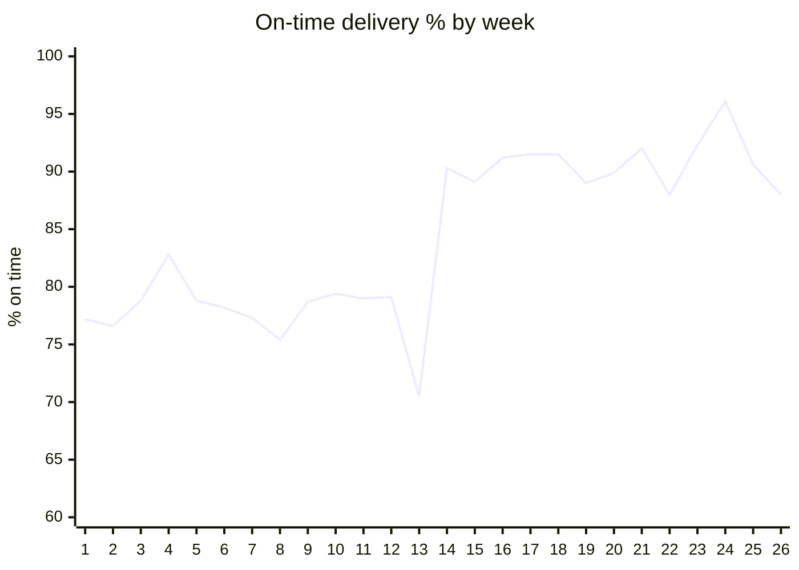

# Fleet KPI Dashboard: 30-Truck Fleet

**Did re-sequencing dispatch schedules and starting a preventive-maintenance program improve on-time delivery and cut downtime?**

> **Sample data.** All trucks, drivers, loads and maintenance records are **synthetic**, modelled on the kind of 30-truck fleet I dispatched and analyzed in fleet management (tracked in Samsara and TruckMate). No real company, customer or driver data is included.

**Tools:** SQL (SQLite)

---

## Key results

On **April 7, 2025**, the fleet made two changes: dispatch schedules were re-sequenced (earlier cross-border departures, GTA runs moved out of rush hour), and a **preventive-maintenance (PM) program** with tracked service intervals began. Comparing 13 weeks before with 13 weeks after:

| KPI | Before | After | Change |
|---|---|---|---|
| On-time delivery | 77.9% | **90.7%** | **+12.8 pts** |
| Avg minutes late per load | 9.9 | **3.8** | −62% |
| Breakdowns (unplanned) | 36 | **25** | −31% |
| Unplanned downtime (hours) | 1,144 | **730** | **−36%** |
| PM services | 22 | 84 | ×3.8 |
| Total maintenance cost (CAD) | $257,391 | **$237,199** | −8% |
| Loads per truck per week | 6.9 | 6.8 | flat |

Spending more on PM (+$53K) was more than offset by fewer breakdowns (−$74K in unplanned repair costs).

Full write-up: **[FINDINGS.md](FINDINGS.md)**

---

## Results

### On-time delivery by week (changes made at week 14)

### On-time % by lane type

| Lane type | Before | After |
|---|---|---|
| Cross-border (Buffalo, Detroit) | 61.9% | **80.9%** |
| Local GTA (Brampton, Barrie) | 76.0% | **90.9%** |
| Domestic long haul (Montreal, Ottawa, Windsor, Sudbury) | 85.2% | **94.2%** |

Cross-border lanes were the weakest before the change (Detroit 60.2%, Buffalo 63.4%) and improved the most.

### Breakdowns by category (26 weeks)

| Category | Breakdowns | Avg downtime (hrs) | Cost (CAD) |
|---|---|---|---|
| Tires | 23 | 28.1 | $143,971 |
| Brakes | 10 | 28.5 | $64,285 |
| Engine / DEF system | 8 | 40.6 | $61,543 |
| Electrical | 7 | 34.8 | $50,267 |
| Aftertreatment (DPF) | 7 | 23.8 | $40,128 |
| Cooling system | 6 | 34.7 | $44,095 |

### Breakdowns by truck age

| Model years | Trucks | Breakdowns | Per truck |
|---|---|---|---|
| 2016–2018 | 7 | 23 | **3.3** |
| 2019–2020 | 7 | 17 | 2.4 |
| 2021–2023 | 16 | 21 | 1.3 |

---

## The data

| Table | Rows | One row = |
|---|---|---|
| `trucks` | 30 | a tractor: make/model, model year, odometer |
| `drivers` | 36 | a driver: long haul / regional / local, years of experience |
| `lanes` | 8 | a regular route: origin, destination, distance, lane type |
| `loads` | 5,335 | one load: truck, driver, lane, scheduled vs actual delivery |
| `maintenance_events` | 167 | a PM service or breakdown: category, downtime hours, cost |

Period: January 6 – July 5, 2025 (synthetic). On-time = delivered no more than 15 minutes after the scheduled time.

## How to reproduce

1. Install **[DB Browser for SQLite](https://sqlitebrowser.org/)** (free).
2. Follow the steps at the top of `sql/00_create_database.sql` to build the database from `data/`.
3. Run `sql/01_kpis.sql`, one query at a time.
